# Kedai POS

**A free, open-source point-of-sale system for Malaysian small shops: kedai runcit, mamak stalls, cafés and mini markets.**

Run it on one shop computer. Staff then take orders and payments from that computer, an iPad or a phone over the shop's Wi-Fi. No monthly fee, no cloud account, and checkout keeps working when the internet is down.

Bahasa Melayu · English · 简体中文 · Cash and DuitNow QR · **Scan-to-order with e-wallet, Apple Pay & Google Pay** · Receipts · Stock · Refunds · Live daily settlement

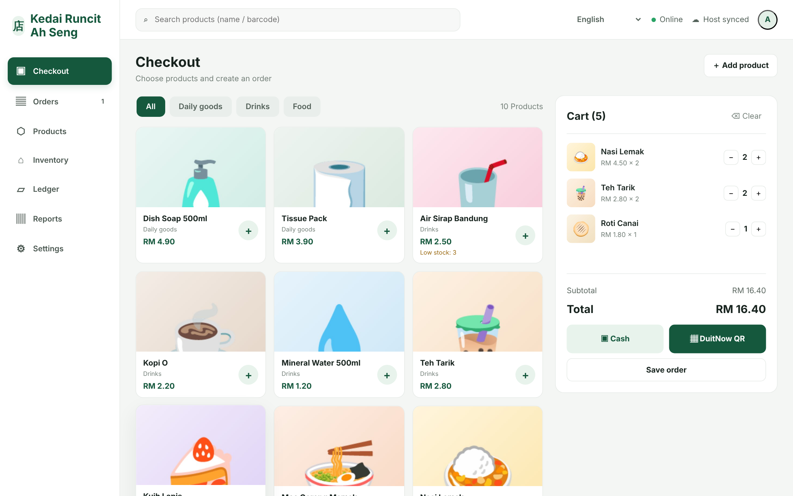

<table>
  <tr>
    <td width="50%">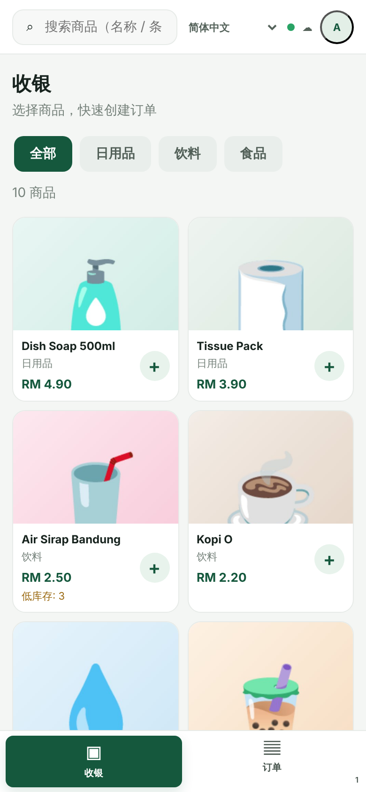</td>
    <td width="50%">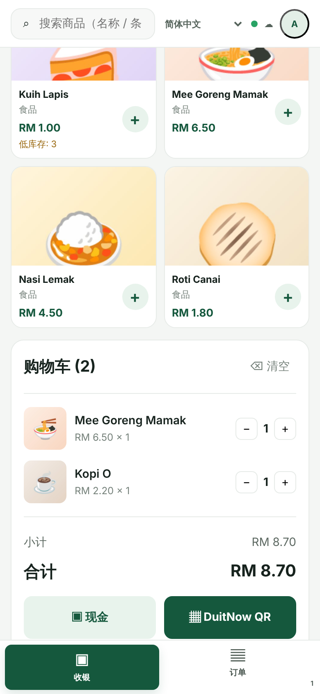</td>
  </tr>
  <tr>
    <td colspan="2" align="center">The same system on a staff member's phone, shown in Chinese. Staff see only Checkout and Orders.</td>
  </tr>
</table>

---

## Contents

- [Install in 5 minutes](#install-in-5-minutes)
- [How to use](#how-to-use)
  1. [Create the owner account](#1-create-the-owner-account)
  2. [Set up your shop](#2-set-up-your-shop)
  3. [Add products](#3-add-products)
  4. [Sell: take an order](#4-sell-take-an-order)
  5. [Get paid: cash or DuitNow QR](#5-get-paid-cash-or-duitnow-qr)
  6. [Orders and receipts](#6-orders-and-receipts)
  7. [Stock and expenses](#7-stock-and-expenses)
  8. [Daily report and backup](#8-daily-report-and-backup)
  9. [Scan-to-order: customers order and pay on their phone](#9-scan-to-order-customers-order-and-pay-on-their-phone)
  10. [Refunds and daily settlement](#10-refunds-and-daily-settlement)
- [Who can do what](#who-can-do-what)
- [FAQ](#faq)
- [More documentation](#more-documentation)

---

## Install in 5 minutes

You need one computer that stays on in the shop (Windows, macOS or Linux) and **Python 3.11 or newer** ([download](https://www.python.org/downloads/)). Nothing else needs to be installed.

1. Download this project: on GitHub click **Code → Download ZIP**, then extract it.
2. Open the `kedai-pos` folder and start the server:
   - **Windows:** double-click `run.bat`
   - **macOS / Linux:** run `./run.sh` (or `python3 server.py`)
3. On the shop computer, open **http://localhost:8765** in a browser.
4. On an iPad or phone connected to the **same shop Wi-Fi**, open `http://<shop-computer-IP>:8765`, for example `http://192.168.1.25:8765`. On Windows, run `ipconfig` to find the IP address.

> If Windows Firewall asks, allow Python on **Private networks** only.

---

## How to use

### 1. Create the owner account

The first time you open Kedai POS, it asks you to create the **owner** account. Choose a strong password: the owner can see sales, change prices and manage staff.

You can switch the language between English, Bahasa Melayu and 简体中文 at any time.

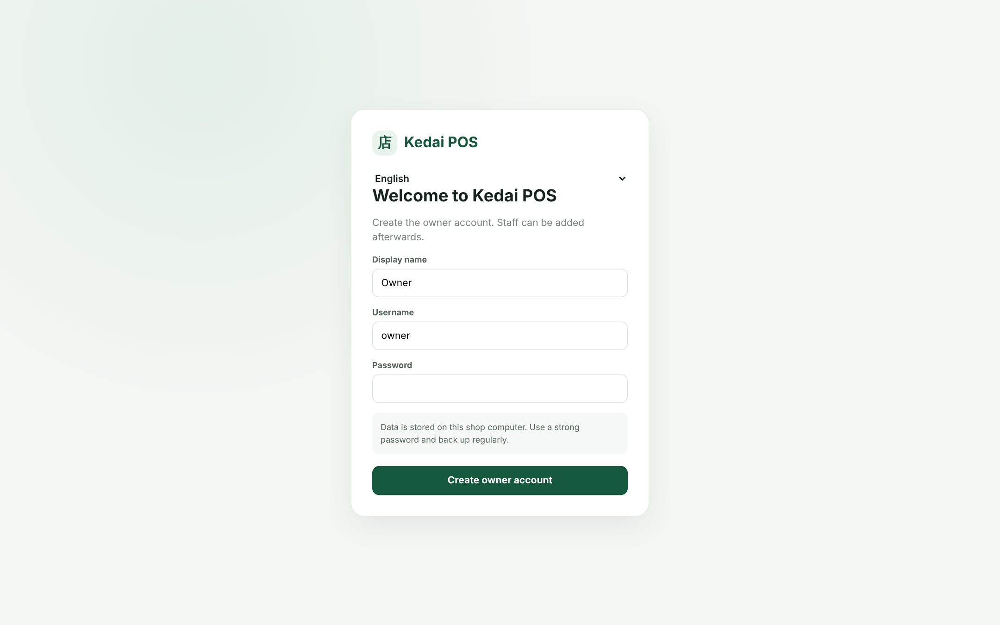

### 2. Set up your shop

Open **Settings**:

- **Shop settings:** shop name, address and phone number. These are printed on every receipt.
- **DuitNow payment QR:** upload a picture of your shop's own DuitNow QR. It is shown to customers at checkout.
- **Tax settings:** turn on only if your shop is SST-registered, and set the rate with your accountant.
- **Staff accounts:** add a login for each worker. You can disable a login when someone leaves.
- **Export backup:** download a ZIP copy of all your data.

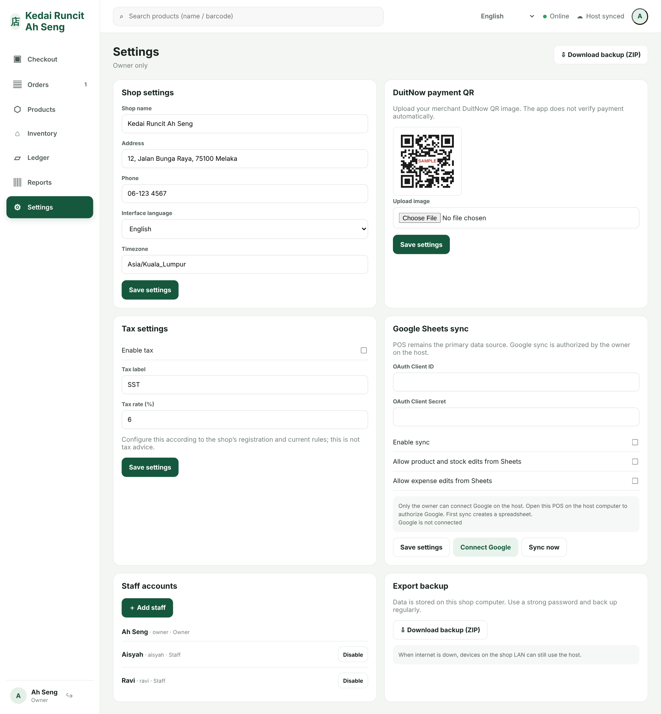

### 3. Add products

Go to **Products → Add product**. Enter the name, category, price, stock quantity and (optionally) a barcode/SKU and photo. Photos are shrunk automatically before upload. Categories you type here become the filter tabs on the checkout screen.

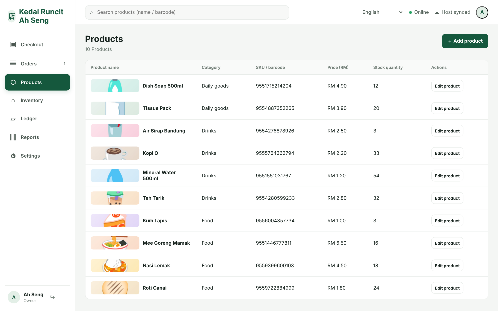

### 4. Sell: take an order

On **Checkout**:

1. Tap a product's **+** to add it to the cart. Tap again to add more, or use **−** / **+** in the cart.
2. Use the category tabs or the search bar (name or barcode) to find items quickly.
3. Choose how the customer pays: **Cash** or **DuitNow QR**.
   Or press **Save order** to keep the order open and collect payment later, e.g. for table orders or a customer who pays at the end.

Products with 5 or fewer left in stock show a **Low stock** warning.

### 5. Get paid: cash or DuitNow QR

**Cash:** type the amount the customer gave you. The change is calculated for you. Press **Confirm payment**.

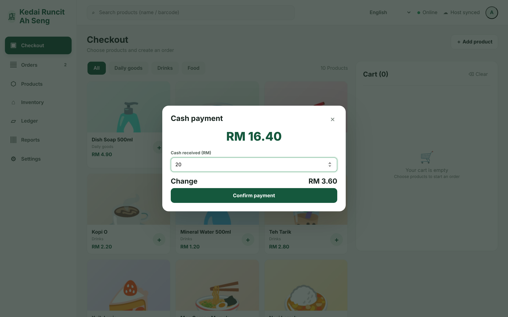

**DuitNow QR:** the customer scans your shop's QR and pays. Check that the money has arrived in your bank or e-wallet app, then press **I confirmed the payment**.

> Kedai POS does **not** connect to your bank, so it cannot see the payment arrive. Always confirm the money has arrived before you press the button.

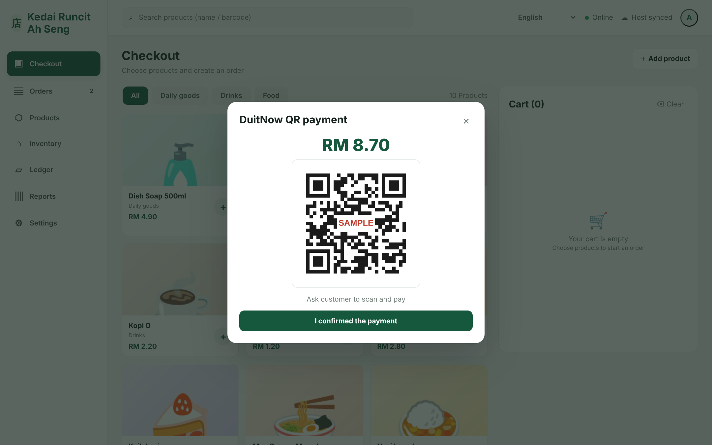

Once paid, the order gets a receipt number and stock is deducted automatically. An order can never be charged twice.

### 6. Orders and receipts

**Orders** lists every order with its status:

- **Open:** saved but not paid. Press **Take payment** to collect, or **Void order** (owner) to cancel it.
- **Paid:** press **View receipt** to show or print it. If you gave the customer their money back, the owner can press **Record refund**, which also puts the items back into stock.

Orders created on any device show up on every other device within a few seconds.

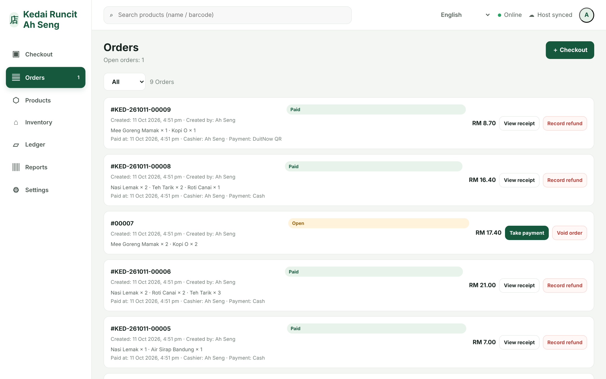

The receipt includes your shop details, items, total, payment method and change. **Print receipt** works with a normal or 80 mm thermal printer, or lets you save the receipt as a PDF.

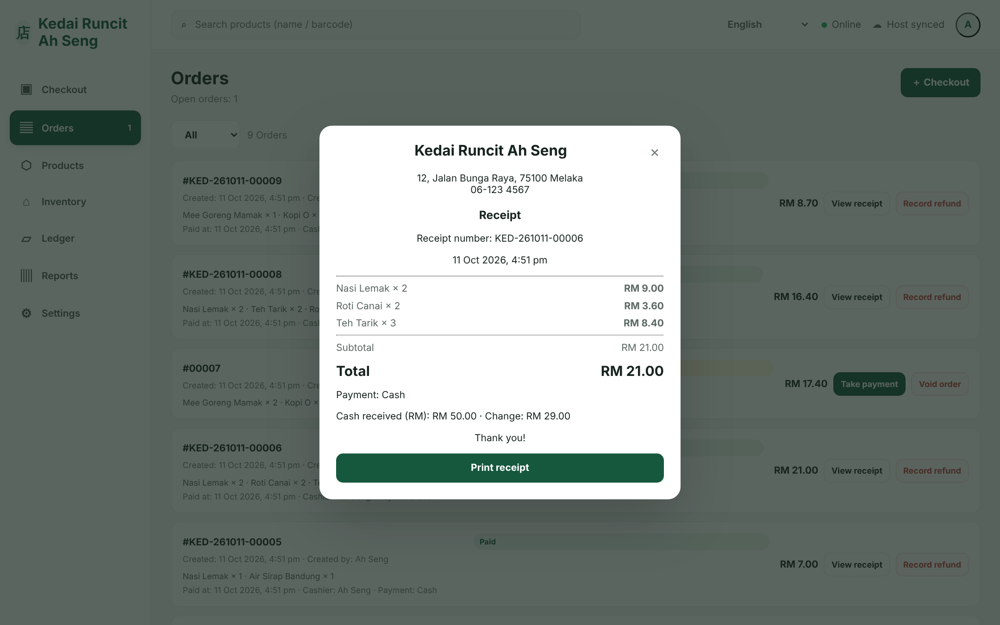

### 7. Stock and expenses

**Inventory** sorts products by quantity, so items running low come first.

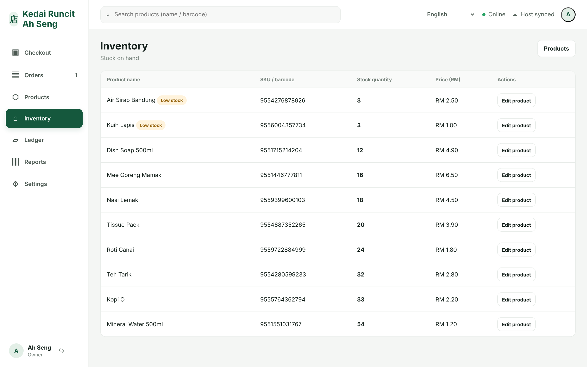

**Ledger** is where the owner records money going out: rent, supplies, utilities and so on. These expenses are subtracted in the daily report.

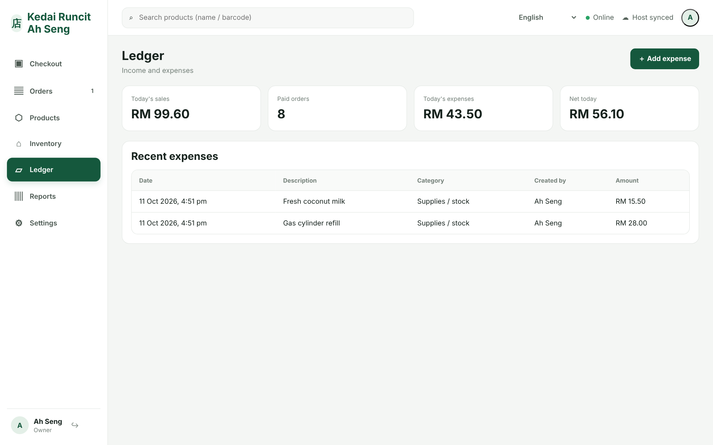

### 8. Daily report and backup

**Reports** shows today's sales, expenses, net amount, open orders, and a breakdown of cash vs DuitNow QR.

Press **Download backup (ZIP)** regularly and keep the file somewhere safe, such as an encrypted USB drive or a private cloud folder.

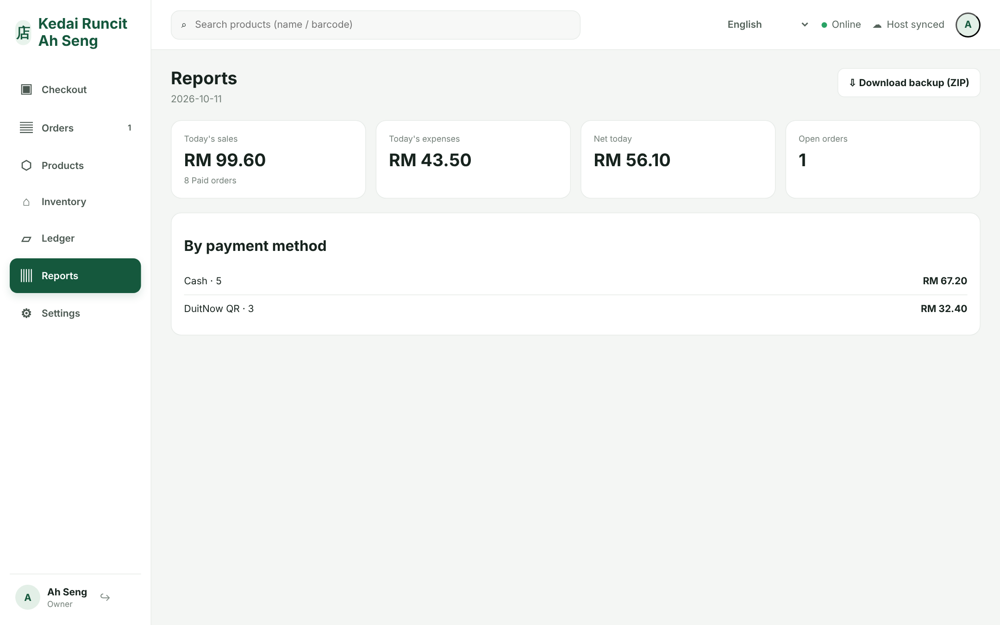

### 9. Scan-to-order: customers order and pay on their phone

Customers don't need an app or an account. Ming sits at Table 3 in your tai chow, scans the QR code on the table, picks the fried bihun, and pays with Touch 'n Go, GrabPay, Boost, ShopeePay, Apple Pay, Google Pay, a card or FPX. The order appears in **Orders** on the POS with a "Scan order · Table 3" tag and a beep, already paid.

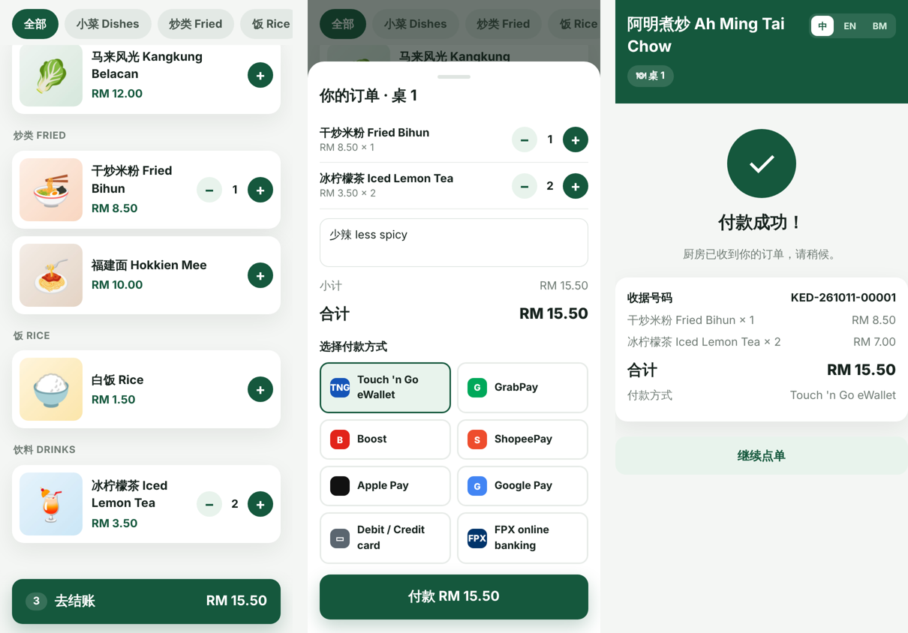

Set it up in **Settings → Scan-to-order**:

1. Tick **Turn on scan-to-order** and choose which payment methods customers may use.
2. Add your tables (e.g. "Table 1", "Takeaway"). Each gets its own QR code. Use **Print all QR codes** and stick them on the tables.
3. So customers can open the menu on mobile data, give the shop computer a public address with [Cloudflare Tunnel](kedai-pos/README.md#scan-to-order-and-online-payments) (free) and enter it as the **public address**. Internet visitors can only reach the customer menu; the POS itself stays on your shop network.

Orders reach the POS **only after payment succeeds**, so there are no unpaid "ghost" orders. If an item sells out while the customer is paying, the payment is refunded automatically.

> **Test mode.** Payments currently run through a built-in *simulated* gateway, and customers are not charged. Before taking real money, the shop needs a merchant account with a payment gateway (for example Fiuu, Stripe or iPay88), which then needs to be connected. See [kedai-pos/README.md](kedai-pos/README.md#scan-to-order-and-online-payments).

### 10. Refunds and daily settlement

**Refunds:** on a paid order, the owner presses **Record refund** and enters the amount (full or partial) and a reason.
- Online payments are refunded to the customer through the payment gateway.
- For cash or DuitNow, hand the money back first, then record it.
- A full refund can put the items back in stock.

**Settlement** (owner only) shows a business day, updated live:
- Gross sales, refunds and net sales.
- A breakdown by payment method.
- How much cash should be in the drawer.
- Every sale and refund with its receipt number and gateway reference.

Sales count on the day they were paid and refunds on the day they were made, so a refund never changes a day that's already closed. At closing time, enter the cash counted to record the day and its variance. Press **Export CSV** to send the day to your accountant.

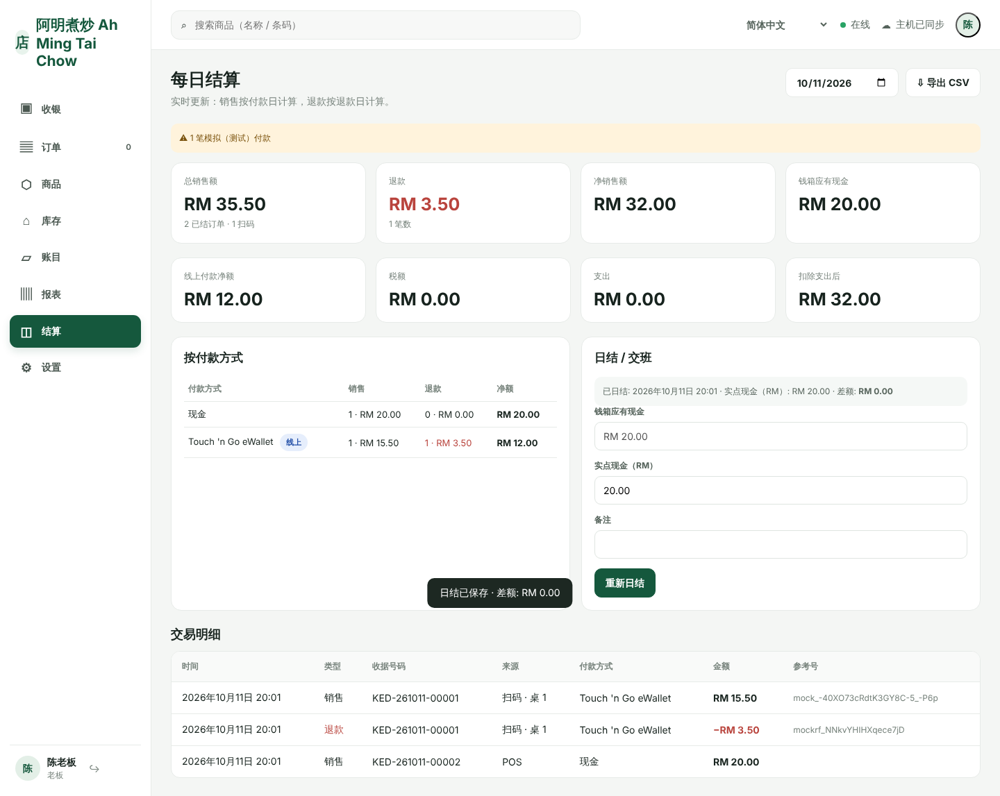

---

## Who can do what

| | Owner | Staff |
|---|:---:|:---:|
| Take orders and payments (cash / DuitNow QR) | ✅ | ✅ |
| View orders and print receipts | ✅ | ✅ |
| Add and edit products, prices and stock | ✅ | — |
| Void open orders, record full or partial refunds | ✅ | — |
| Expenses, reports, settlement and backup | ✅ | — |
| Shop settings, staff accounts, tables & QR codes, Google Sheets | ✅ | — |

---

## FAQ

**Does it work without internet?**
Yes. All devices talk to the shop computer over your Wi-Fi router, so checkout keeps working when the internet is down. The shop computer and router just need to stay on.

**Where is my data stored?**
Only on the shop computer, in `kedai-pos/data/`. Nothing is uploaded unless you turn on the optional Google Sheets sync.

**Can I use a barcode scanner?**
Yes. Most USB/Bluetooth scanners type like a keyboard and press Enter after each scan. On **Checkout**, click the search bar and scan: a product whose SKU/barcode matches exactly is added straight to the cart.

**Someone keeps guessing passwords. What happens?**
After 5 wrong passwords for an account within 15 minutes, that device is locked out of that account for a while. Every failed attempt is recorded.

**Do customers need to download an app or sign up?**
No. They scan the table's QR code with the phone camera and the menu opens in the browser.

**Does scan-to-order work when the shop's internet is down?**
No. Customers' phones reach the shop computer over the internet, and payments need the gateway. Counter checkout keeps working offline as usual.

**Is this certified e-Invoice / MyInvois or SST software?**
No. It is a simple shop POS. Check with your accountant and the [LHDN e-Invoice](https://www.hasil.gov.my/e-invois/) rules for what your business needs.

---

## More documentation

See **[kedai-pos/README.md](kedai-pos/README.md)** for:

- Scan-to-order setup: Cloudflare Tunnel, security model, connecting a real payment gateway
- Google Sheets sync setup
- Restoring from a backup
- Environment variables (port, data folder, timezone)
- Connectivity model and legal notes
- Running the tests

The screenshots on this page come from a demo shop with sample data. To regenerate them, see [`docs/screenshots/capture.mjs`](docs/screenshots/capture.mjs).
